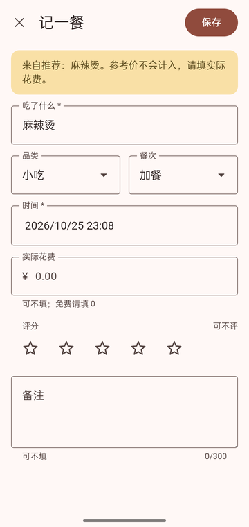
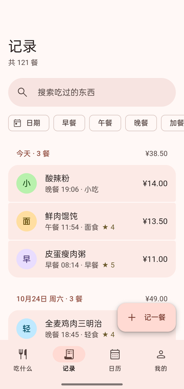
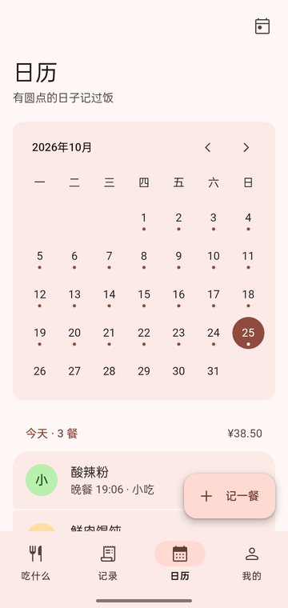
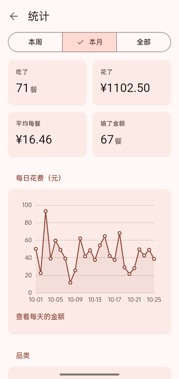
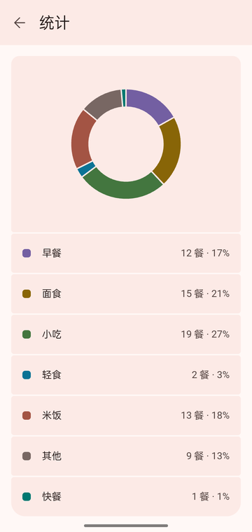
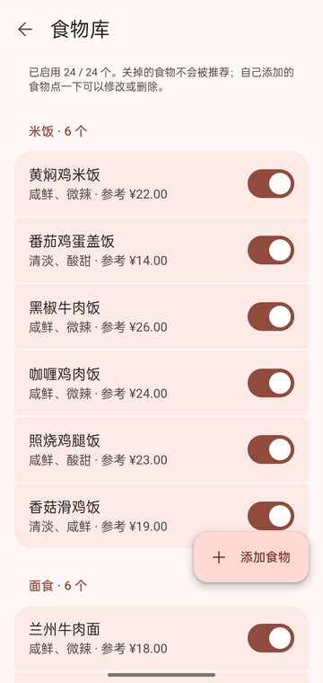

# EatWhat · 吃什么

今天吃什么，以及今天吃了什么，还有昨天吃了什么。

EatWhat 是一个离线运行的 Android 应用：帮你从食物库里随机挑一餐，记下实际吃了什么、花了多少，再用日历和统计回顾饮食习惯。无需注册，数据只保存在手机本地。

| 推荐 | 记一餐 | 记录 | 日历 |
| :--: | :----: | :--: | :--: |
|  |  |  |  |

| 统计 | 品类占比 | 食物库 |
| :--: | :------: | :----: |
|  |  |  |

## 功能

- **今天吃什么**：按预算、品类、口味筛选，随机推荐一道菜；“换一个”不会连续抽到同一个，最近吃过的会少出现。
- **记一餐**：“就吃这个”自动预填表单，也可以直接手填。记录食物、品类、餐次、时间、实际花费、评分和备注。
- **记录**：按日期分组浏览，支持搜索和按日期、餐次筛选，可修改、删除。
- **日历**：按月查看，有记录的日子带圆点，可查看某天明细或补记。
- **统计**：本周、本月、全部的餐数、总花费、平均每餐、每日花费趋势、品类占比和常吃食物。
- **食物库**：内置 24 种食物，可添加、修改、删除自己的食物，并选择哪些参与推荐。
- **偏好设置**：默认预算、常吃品类和口味、近期去重天数。

## 技术栈

Vue 3 · Vite · Vue Router · Vant · ECharts · Capacitor 8（Android）· Capacitor Preferences（本地存储）

## 构建

### 环境

- Node.js 22.12 或更高版本
- Android Studio，含 Android SDK 36
- JDK 21

### 步骤

```bash
npm install
npm test               # 运行单元测试
npm run dev            # 浏览器中开发调试
npm run android:sync   # 构建前端并同步到 android/
```

生成调试 APK（输出到 `android/app/build/outputs/apk/debug/app-debug.apk`）：

```bash
cd android
./gradlew assembleDebug
```

手机开启 USB 调试并连接电脑后安装：

```bash
adb install -r android/app/build/outputs/apk/debug/app-debug.apk
```

也可以用 `npm run android:open` 在 Android Studio 中打开工程并直接运行。

### 演示数据

`npm run seed:device` 会向已连接手机上的调试版应用写入最近 6 周的演示记录。写入前会先在电脑上备份手机里的原数据，只替换之前写入的演示记录。

## 许可证

[GPL-3.0](LICENSE)
